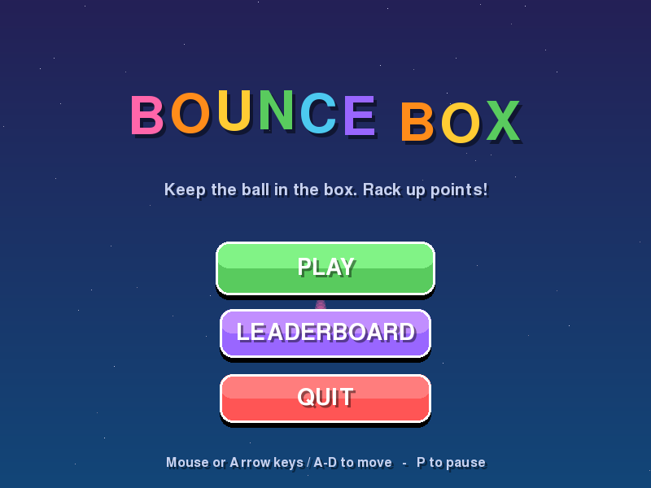
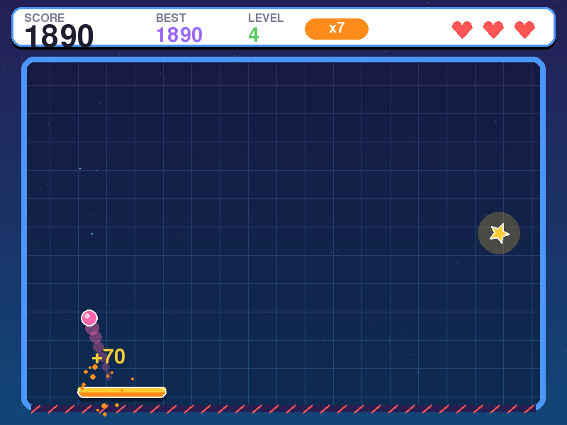
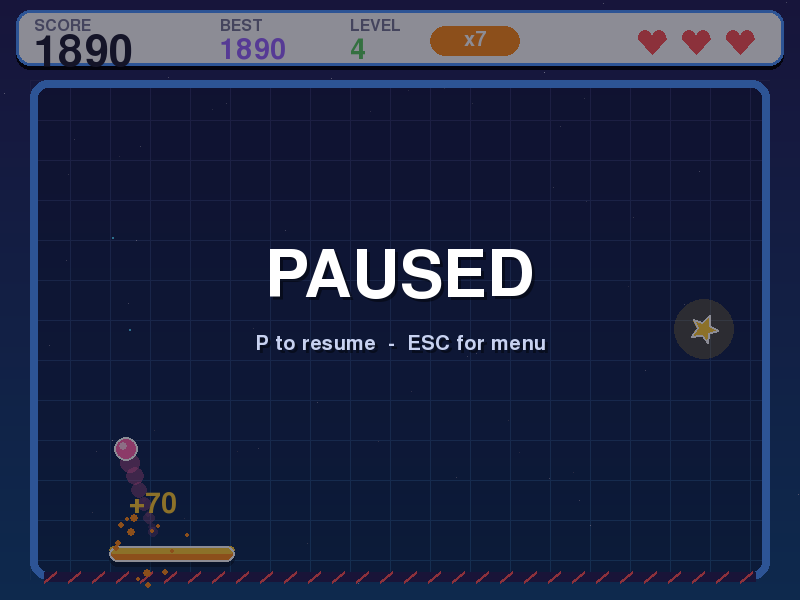

# Bounce Box

A simple, colorful arcade game made with **pygame**. Keep the ball bouncing inside the box with your paddle, rack up points, and get your name on the leaderboard.

## Download & play (Windows)

Grab **BounceBox.exe** from the [latest release](../../releases/latest) and double-click it. No install or Python needed.

> Windows SmartScreen may warn about an unsigned app: click **More info → Run anyway**.

## How to play

| Control | Action |
| --- | --- |
| Mouse, ← → or A / D | Move the paddle |
| P or Esc | Pause |
| Space / Enter | Start from the menu |

- Every paddle hit scores **10 × multiplier**.
- Hit 5 in a row to raise the multiplier (up to **x5**).
- Every 10 hits is a new **level**, and the ball gets faster.
- Hit the yellow ⭐ with the ball for **50 × multiplier** bonus points.
- You have 3 lives. Make the top 10 and you can type your name in.

Scores are saved to `%APPDATA%\BounceBox\leaderboard.json`.

## Screenshots

| | |
| --- | --- |
|  |  |
|  |  |
|  |  |

## Run from source

```bash
pip install -r requirements.txt
python bounce_box.py
```

## Build the .exe

On Windows:

```bash
pip install pyinstaller -r requirements.txt
pyinstaller --onefile --windowed --name BounceBox bounce_box.py
```

From Linux (via Docker + Wine):

```bash
docker run --rm -v "$(pwd):/src/" --entrypoint /bin/bash batonogov/pyinstaller-windows:latest \
  -c "pip install -r requirements.txt && pyinstaller --onefile --windowed --name BounceBox bounce_box.py"
```
